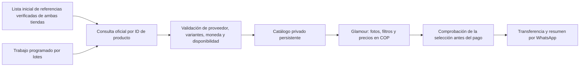

# Catálogo de Glamour sin suscripción a un intermediario

Decisión del usuario, 5 de octubre de 2026: se admite comenzar con 200–500 productos de cada tienda y no se desea una suscripción para obtener o actualizar los datos. Este documento propone la conexión; no acredita una importación realizada.

## Ruta recomendada

Conservar la web actual y construir una integración propia con la API oficial de dropshipping de AliExpress, si la cuenta obtiene los permisos necesarios. Importar primero 10 artículos por proveedor, ampliar a 200 por proveedor y después a 500 cuando la cobertura y las cuotas lo permitan.

No contratar DSers, Shopify ni un servicio de extracción. Tampoco sustituir la estética, la bolsa o el cierre por WhatsApp que ya existen.

## Dos problemas distintos

**Descubrimiento inicial:** hacen falta los IDs reales de los productos de las tiendas `821117` y `1101290000`. No encontré un endpoint público oficial documentado que garantice enumerar una tienda ajena por su URL. Obtener una exportación del proveedor o una lista procedente de una integración autorizada es una vía válida. Basta con los enlaces o IDs; no es necesario pedir que adjunten cada fotografía. Si el panel actual ofrece búsqueda por tienda, verificarla con ambas antes de adoptarla. No llamar «más vendidos» a una lista sin un ranking comprobable.

**Actualización:** la documentación de [`aliexpress.ds.product.get`](https://developer.alibaba.com/docs/api.htm?apiId=60452) describe consultas por ID con destino, idioma y moneda. La respuesta incluye tienda, imágenes y variantes con importes y disponibilidad. Esto permite diseñar la actualización de una selección estable sin volver a recorrer todo el catálogo diariamente. Los datos de video descritos no garantizan una URL reproducible; comprobar cada caso.

## Acceso de la cuenta

La [guía oficial de dropshipping](https://developer.alibaba.com/docs/doc.htm?articleId=120418&docType=1&treeId=762) describe una cuenta compradora, registro de desarrollador, aplicación aprobada y autorización de la cuenta de dropshipping. Es una vía diferente de las APIs de vendedor: no equivale a necesitar acceso a las contraseñas de ambos proveedores. Esa guía está marcada como obsoleta; no se asumen vigentes sus plazos ni se implementa su protocolo antiguo sin contrastarlo con el panel actual.

La revisión del navegador también bloqueó `https://open.aliexpress.com` por política de seguridad. No se intentará abrir la misma página mediante otro mecanismo. El siguiente paso externo es que el titular abra la plataforma oficial e inicie sesión por su cuenta, y confirme si ofrece la categoría Dropshipping y el registro de aplicaciones. No necesita compartir contraseñas ni pegar secretos en el chat.

Datos preparados para la solicitud, si esa categoría está disponible:

- Nombre: **Glamour Boutique Cali — catálogo propio**.
- Finalidad: mantener una selección de prendas de dos proveedores, mostrar imágenes y variantes en una tienda propia en español, consultar precios para Colombia y actualizar el catálogo.
- Alcance inicial: 400 productos, con posibilidad de llegar a 1.000; indicar además consultas de validación y reintentos al solicitar la cuota.
- Cuenta: compradora/dropshipping de Glamour. No declarar que Glamour es dueña de las dos tiendas de AliExpress.
- Sitio: proyecto existente Glamour Boutique Cali. La revisión de Vercel está protegida; confirmar qué URL pública exige AliExpress antes de presentar la solicitud.
- Callback: proporcionar una dirección HTTPS real solo después de verificar el flujo de autorización vigente e implementar la ruta. No registrar una ruta inexistente.

## Piloto que debe aprobarse antes de importar cientos

1. Consultar 10 referencias de cada tienda con destino Colombia y moneda de origen definida, preferiblemente USD. Verificar que el ID de tienda de la respuesta coincide con el proveedor esperado.
2. Comparar las fotos, los nombres, cada talla/color, el precio unitario aplicable y la disponibilidad. Separar promociones condicionadas, precios mayoristas y envío; no usar automáticamente el menor importe de la respuesta.
3. Conservar la referencia original y el ID de cada variante. Traducir títulos sin inventar material, características ni opciones.
4. Repetir la consulta y verificar que la actualización modifica los datos correctos. Ante un fallo, conservar los datos anteriores con su antigüedad; un error no es una baja de producto.
5. Probar una selección completa de la bolsa, incluidos un cambio de precio y una variante agotada, antes de habilitar transferencias.

El margen continúa pendiente. Importar costos reales no autoriza a publicarlos como precio final de Glamour.

## Actualización sin cuota mensual de automatización

Un proceso programado consultaría únicamente los IDs seleccionados. Para 400 productos, una vuelta completa requiere aproximadamente 400 consultas de detalle si la API no ofrece lotes; para 1.000, unas 1.000. Son estimaciones de volumen, no cuotas concedidas.

La ejecución larga debe ir en un trabajo por lotes con pausas, reintentos limitados y checkpoints, no dentro de una única petición web de 120 segundos. GitHub documenta ejecución gratuita en repositorios públicos con runners estándar: [facturación de Actions](https://docs.github.com/en/actions/concepts/billing-and-usage). Esta opción se evaluará con los permisos reales de la API. Las claves y los datos privados irían en secretos y almacenamiento privado, nunca en commits ni logs públicos. Solo debe existir un programador activo.

Separar `sourceModifiedAt` (último cambio informado), `fetchedAt` (consulta correcta de la API) y `publishedAt` (publicación de la instantánea). Guardar una respuesta antigua otra vez no la vuelve vigente. Un plazo de caché del proveedor también debe respetarse: la hora de nuestra lectura no elimina ese retraso.

El servidor deberá volver a consultar las variantes del pedido antes del pago cuando la API lo permita. Hoy la web comprueba su instantánea local; todavía no realiza esa consulta directa a AliExpress. Si una validación falla o la cuota no alcanza, la selección pasa a confirmación por WhatsApp, sin total pagable presentado como verificado.

La publicación de una selección será una instantánea completa de los IDs elegidos, no una afirmación de que contiene toda la tienda. Debe existir un manifiesto con proveedor e ID, y estados explícitos para retirados, fallidos y pendientes. No descartar silenciosamente productos por un fallo parcial.

## Qué se puede prometer y qué falta

La propuesta elimina la suscripción a un intermediario. No permite garantizar que todo servicio relacionado sea gratuito: AliExpress distingue APIs gratuitas y de pago en su [acuerdo público](https://terms.alicdn.com/legal-agreement/terms/suit_bu1_aliexpress/suit_bu1_aliexpress202201220006_10755.html), y las condiciones, permisos y cuotas concretas deben comprobarse en la cuenta antes de activar cualquier cobro. El alojamiento y el almacenamiento tienen sus propias condiciones.

**Pendientes externos:** acceso aprobado de la cuenta, condiciones/cuotas vigentes y listado inicial verificable de las dos tiendas. **Pendientes técnicos después del acceso:** adaptador real, autorización y renovación de credenciales, manifiesto de selección, trabajo por lotes y validación en directo del pedido. No se obtuvieron productos nuevos ni se activó esta conexión durante la investigación.

Si no se concede la API, la alternativa sin suscripción es que los proveedores entreguen un archivo o enlace de catálogo que actualicen periódicamente. Un archivo estático sirve para cargar la colección una vez; no resuelve por sí solo los cambios diarios de precio. No se sustituirá el acceso autorizado por mecanismos que eludan los bloqueos de navegación.
